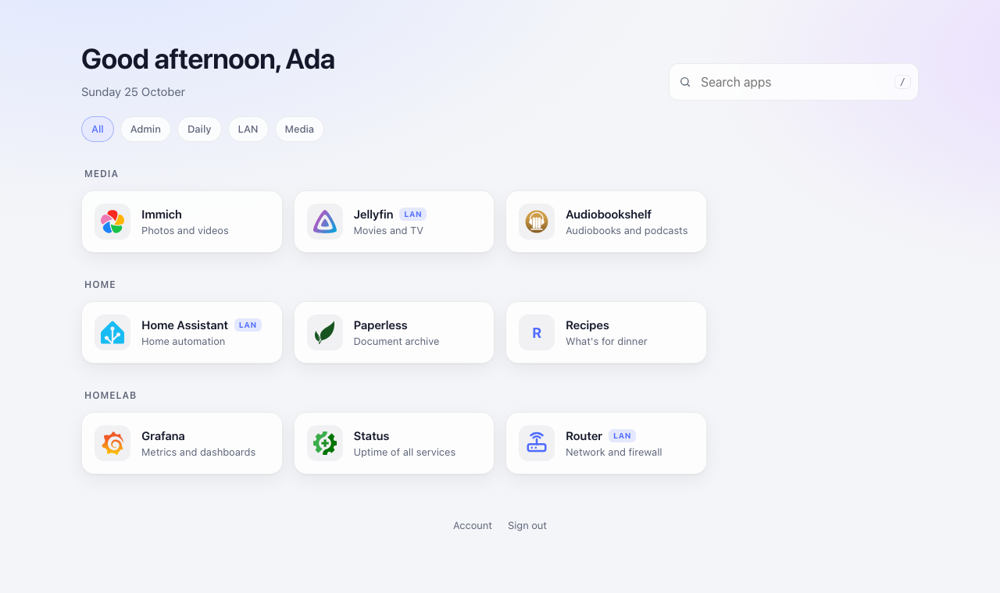

<div align="center">
	
	<h1>doormat</h1>
	<p>The first thing you step on in your homelab. Wipe your feet, pick an app.</p>
	<p>
		<a href="https://github.com/linusfr/doormat/releases/latest"></a>
		<a href="https://github.com/linusfr/doormat/actions/workflows/ci.yml"></a>
		<a href="https://github.com/linusfr/doormat/pkgs/container/doormat"></a>
		<a href="LICENSE"></a>
	</p>
</div>

A start page from one YAML list, rendered by Caddy. Behind forward auth (Authelia,
Authentik, …) each user gets only their granted apps — filtered on the server, so
the rest never reaches the browser.

<picture>
	<source media="(prefers-color-scheme: dark)" srcset="images/dark.png">
	
</picture>

## Quickstart

```sh
curl -fsSLO https://raw.githubusercontent.com/linusfr/doormat/main/examples/apps.md
docker run --rm -p 8080:8080 -e DOORMAT_AUTH=off -v "$PWD/apps.md:/srv/apps.md:ro" ghcr.io/linusfr/doormat
```

[`examples/apps.md`](examples/apps.md) documents every field. Own icons go in `/srv/icons`.

## Behind forward auth

Drop `DOORMAT_AUTH=off`. A user then sees an app when `Remote-Groups` holds `<slug>:member`:

```caddyfile
start.example.com {
	forward_auth authelia:9091 {
		uri /api/authz/forward-auth
		copy_headers Remote-User Remote-Groups Remote-Name
	}
	reverse_proxy doormat:8080
}
```

> [!IMPORTANT]
> doormat trusts the groups header. Keep it reachable only through the proxy, and make
> sure the proxy drops a groups header the client sent (Caddy's `forward_auth` does).

| Variable | Default | |
|---|---|---|
| `DOORMAT_AUTH` | `headers` | `off` shows every app |
| `DOORMAT_GROUPS_HEADER` | `Remote-Groups` | Authentik: `X-authentik-groups` |
| `DOORMAT_GROUPS_SEPARATOR` | `,` | Authentik: `\|` |
| `DOORMAT_GROUP_FORMAT` | `%s:member` | `%s` is the app's slug |
| `DOORMAT_NAME_HEADERS` | `Remote-Name,Remote-User` | First non-empty one greets |
| `DOORMAT_HEALTH_INTERVAL` | `60s` | How often `health` targets are checked |
| `DOORMAT_PORT` | `8080` | |

## Health

Add `health` to a tile to have it marked when the app is down: `true` checks its `url`, `/path` checks that path on
the same host, a full URL checks anything else, such as an internal address. Any response below
HTTP 500 within 5 seconds counts as up, so login redirects and 401s do too. doormat runs the
checks itself; the page only shows their last result. While any app is down, a Down chip filters for them.

## Modules and background

Widgets go under the date, in the order of `modules:` in `apps.md`. Each entry names its module
and takes that module's parameters:

```yaml
modules:
  - module: weather   # Open-Meteo, fetched by the browser; no API key
    locate: browser   # optional: each viewer's own position, once they allow it
    postcode: "10115" # fallback, or city: Hamburg, or latitude/longitude
    country: de
```

A module is one file in [`site/modules/`](site/modules). Adding one takes that file, its
`import` at the top of `site/index.html`, and a branch where `.modules` renders.

`background: backgrounds/sky.jpg` (mount `/srv/backgrounds`) or a URL puts an image behind the
page, dimmed per theme so the tiles stay readable. `search: false` leaves out the search box.

## Development

`source bin/activate-hermit` for the toolchain, then `just dev` (live reload) or
`just dev-as "<groups>"`; `just --list` has the rest. `just design` lints the page with
[impeccable](https://github.com/pbakaus/impeccable); `just design-setup` adds its skill to
Claude Code. Conventional Commits drive
releases: a `feat` or `fix` on `main` tags a version and pushes the image.

## License

[MIT](LICENSE)
